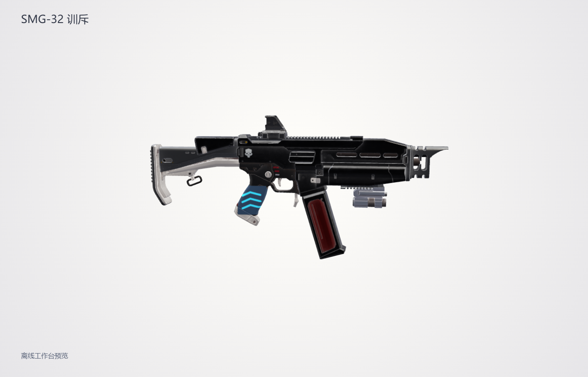
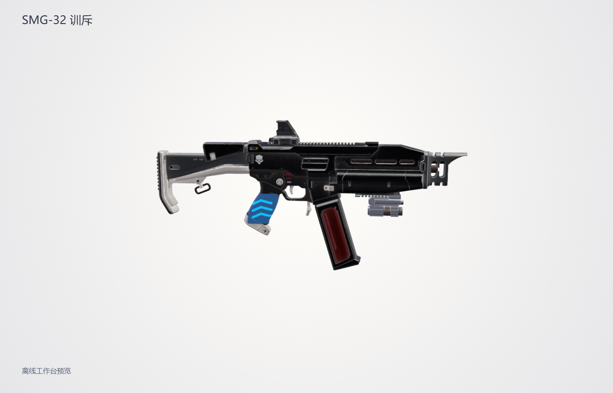

# WeaponPaintTool

**本软件没有 Windows 数字签名，Windows 可能阻止启动。**

这是 Helldivers 2 武器涂装工具的测试版。主手武器的发光和图片添加已通过游戏内测试。副手武器和投掷武器尚未测试。流光和呼吸在任务中播放，军械库显示亮灯外观。

解压 Release 中的 Windows x64 包，运行 `WeaponPaintTool.exe`。首次启动时选择游戏安装目录，工具会准备模型和原装材质预览。每次发布的新版本从空白工程开始。

导出可能需要 10 分钟以上。超过 10 分钟且进度一直停滞，大概率出了问题，请把导出报告私发给维护者。报告位于 `data/1.7.3/reports`。

## 效果

## 许可

禁止售卖本软件和修改版。支持非商业二次开发，须保留原作者和可点击水印。开发时可沿用 Release 的运行库和预览资源。完整条款见 [LICENSE](LICENSE)。
